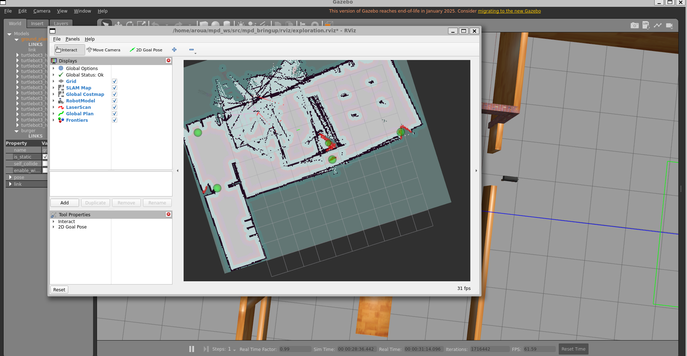

# mpd_bringup: Simulation and autonomous mapping (baseline)

Part of the **Map → Plan → Drive** project for *Special Aspects of Mobile Autonomous Systems* (TH Köln, WS 26/27).
This package is **Person 1's part**: a working simulation in which a TurtleBot3 explores an unknown building on its own and builds a map. It is the **baseline and test platform** for the team. Our own mapping, A* planner and fuzzy controller will be developed against it and swapped in later.

**Author:** Achraf Aroua

---

## What I did

1. **Set up the environment** on Windows with WSL2: Ubuntu 22.04, ROS 2 Humble, Gazebo Classic, TurtleBot3, Nav2 and slam_toolbox.
2. **Built the workspace** with `explore_lite` (frontier exploration, built from source from `m-explore-ros2`) and this package.
3. **Wrote one launch file** (`launch/exploration.launch.py`) that starts the whole stack with a single command:
   Gazebo + TurtleBot3 → slam_toolbox (map) → Nav2 (drive) → explore_lite (choose the next frontier) → RViz2.
4. **Created an RViz2 configuration** (`rviz/exploration.rviz`) showing the SLAM map, laser scan, costmap, planned path, robot model and frontiers.
5. **Ran autonomous exploration** in the TurtleBot3 house world and **saved the resulting map** (`maps/`).

```
Gazebo (TurtleBot3) ──/scan,/odom──▶ slam_toolbox ──/map──▶ explore_lite ──goal──▶ Nav2 ──/cmd_vel──▶ robot
                                                         └──/explore/frontiers──▶ RViz2
```

## Results

**The simulation world:** TurtleBot3 house in Gazebo. The blue fan is the robot's 360° laser scanner.



**First launch:** all RViz displays load with *Global Status: Ok*, and the first part of the map appears around the robot.


**Map built autonomously:** after about 28 minutes of simulated time the robot had mapped most of the house on its own. White/grey cells are free, black cells are walls, and the green spheres are the remaining frontiers (edges between known and unknown space).


## Problems I ran into and how I solved them

| Problem | Cause | Fix |
|---|---|---|
| Build failed: `explore_lite_msgs` not found | explore_lite depends on a message package in the same repo | Build with `--packages-up-to explore_lite mpd_bringup` |
| Launch crashed: `No such file or directory: ''` | Gazebo's launch file sets an empty `params_file`, which leaked into Nav2 | Run each included launch in its own `GroupAction` and pass the Nav2/SLAM parameter files explicitly |
| Robot explored outside the house | Default spawn point (-2.0, -0.5) is outside the house, and the house has open doors | Added `x_pose`/`y_pose` launch arguments and spawn at (-1.0, 2.8) inside |
| Robot stuck in a "Reached the goal" loop | explore_lite sent a frontier only ~24 cm away, inside Nav2's goal tolerance, so the robot never moved and SLAM never updated | Nudge the robot once with teleop at the start |
| Smeared walls in one corner of the map | Robot hit furniture; the laser at ~17 cm height sees table legs but not tabletops, and wheel slip corrupted the pose | Increased Nav2 `inflation_radius` from 0.55 m to 0.75 m |

## How to run it

Requirements: Ubuntu 22.04, ROS 2 Humble, and the packages
`ros-humble-gazebo-ros-pkgs ros-humble-turtlebot3 ros-humble-turtlebot3-simulations ros-humble-navigation2 ros-humble-nav2-bringup ros-humble-slam-toolbox`.

```bash
mkdir -p ~/mpd_ws/src && cd ~/mpd_ws/src
git clone https://github.com/robo-friends/m-explore-ros2.git
git clone https://github.com/achref-2/ams-map-plan-drive.git mpd_bringup
cd ~/mpd_ws
rosdep install --from-paths src --ignore-src -r -y
colcon build --symlink-install --packages-up-to explore_lite mpd_bringup
source install/setup.bash
export TURTLEBOT3_MODEL=burger

# Autonomous exploration of the house
ros2 launch mpd_bringup exploration.launch.py world:=turtlebot3_house x_pose:=-1.0 y_pose:=2.8

# Save the map (second terminal)
ros2 run nav2_map_server map_saver_cli -f ~/maps/tb3_house
```

Options: `world:=turtlebot3_world` (smaller, closed world), `explore:=false` (no autonomous exploration; drive with teleop or click a *2D Goal Pose* in RViz), `rviz:=false`.

## Files

```
mpd_bringup/
├── launch/exploration.launch.py   # whole stack in one command
├── config/explore_params.yaml     # explore_lite settings
├── config/nav2_params.yaml        # Nav2 settings (inflation_radius 0.75)
├── rviz/exploration.rviz          # saved RViz2 view
├── maps/                          # saved house maps (.pgm + .yaml)
└── docs/                          # screenshots for this README
```

## Next steps

- Own occupancy-grid mapping node, compared against slam_toolbox
- Evaluation tools: exploration time, map coverage, number of collisions
- Recorded rosbags (`/scan`, `/odom`, `/tf`, `/map`) so teammates can test offline
